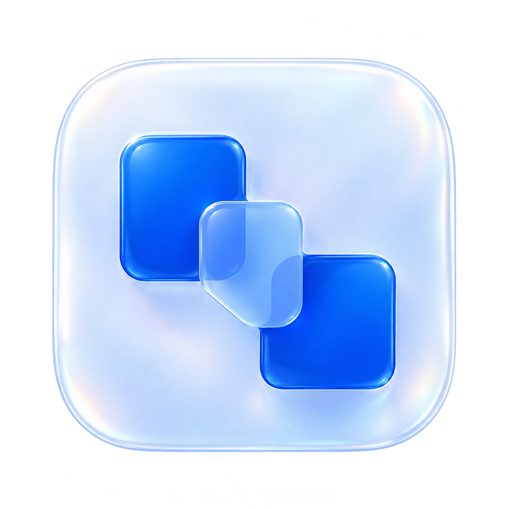
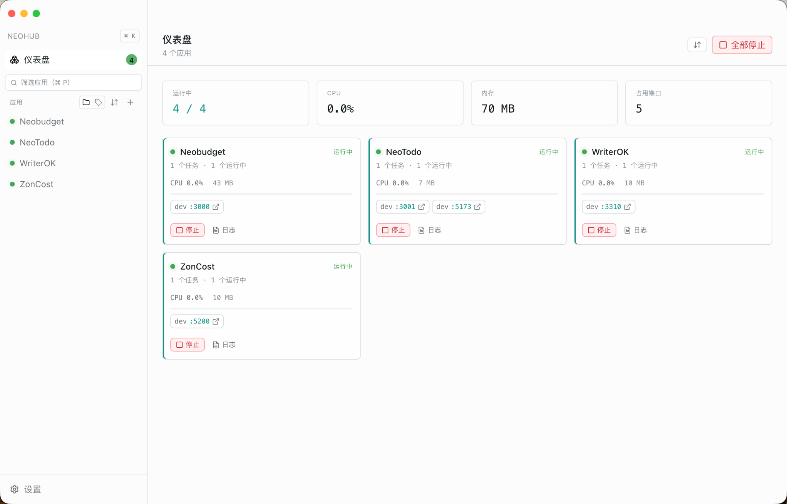

<p align="center">
  
</p>

<h1 align="center">NeoHub</h1>

<p align="center"><strong>让本地项目，都有一个统一的入口。</strong></p>
<p align="center">A home for your local projects.</p>

<p align="center">
  在一个 macOS 桌面窗口中，启动应用、查看日志、管理端口，掌握每个项目的运行状态。
</p>

<p align="center">
  <a href="LICENSE"></a>
  
  
  <a href="https://github.com/jainath/devharbor"></a>
</p>

<p align="center">
  <a href="#安装macos">安装</a> ·
  <a href="#快速开始">快速开始</a> ·
  <a href="#功能一览">功能一览</a> ·
  <a href="#从源码运行">从源码运行</a> ·
  <a href="https://github.com/neotu23/NeoHub/issues">反馈问题</a> ·
  <a href="#上游与致谢">上游与致谢</a>
</p>

> **Fork 声明**：NeoHub 基于 [Jainath Ponnala](https://github.com/jainath) 的 [DevHarbor](https://github.com/jainath/devharbor) Fork 并进行定制开发，由本仓库独立维护，并非 DevHarbor 官方发行版。感谢上游提供的项目基础。



## 安装（macOS）

> **当前发布包未经过 Apple Developer ID 签名与公证。** 功能与从源码构建的版本完全一致，只是首次打开时 macOS 会拦截一次，按下面的方式之一放行即可。

1. 从 [Releases](https://github.com/neotu23/NeoHub/releases) 下载 `NeoHub-<版本>-arm64.dmg`。
2. 打开 dmg，把 **NeoHub** 拖进「应用程序」。
3. 首次启动若提示无法验证开发者，打开 **系统设置 → 隐私与安全性**，在底部点击 **仍要打开**，再确认一次。

也可以先用命令行清除隔离标记，之后双击即可正常打开：

```bash
xattr -dr com.apple.quarantine /Applications/NeoHub.app
```

几点说明：

- 目前只提供 `arm64`（Apple Silicon）构建；Intel Mac 请按[从源码运行](#从源码运行)自行构建。
- 未签名构建无法使用应用内自动更新（`squirrel.mac` 会校验 Developer ID 签名），升级时请回到 Releases 手动下载新版本。
- 要做到「双击即开、无任何提示」，需要付费 Apple Developer 账号签发的 Developer ID 证书并通过 Apple 公证；本仓库暂未配置。

## 为什么使用 NeoHub？

当你同时维护几个 Next.js、React 或 Node.js 项目，终端窗口很快就会堆满：哪个服务还在运行？哪个项目占用了端口？报错日志又在哪个窗口？

NeoHub 把这些日常操作集中到一个桌面应用中。导入项目后，可以直接启动、停止和重启服务，点击端口打开页面，也可以随时查看日志、资源占用与任务状态。

项目仍在各自的目录中运行，使用各自的依赖和 Node.js 环境。NeoHub 负责统一管理进程；各个服务的内存占用仍取决于项目本身与启动方式。

## 功能一览

### 一个窗口，看清所有应用

仪表盘汇总运行中的应用数量、CPU、内存和占用端口。每张应用卡片显示任务状态、资源用量和访问地址，支持直接停止服务或进入日志。

### 导入一次，随时启动

选择项目目录，自动识别包管理器、Node.js 版本要求、`package.json` 脚本与 `.env` 文件。支持扫描文件夹批量导入项目，也支持为 Monorepo 的工作区创建多个任务。

### 多个任务，按顺序运行

一个应用可以包含前端、API 等多个任务。配置任务依赖和就绪检查后，按依赖顺序启动，停止时按反向顺序清理进程。既可以控制整个应用，也可以单独操作某个任务。

### 日志、端口和运行环境，就在手边

- **实时日志**：终端式输出、搜索、正则筛选，以及跨应用日志搜索；任务崩溃时保留末尾输出，方便排查。
- **端口检测**：显示服务监听的端口，点击即可在浏览器打开。
- **Node.js 版本**：按项目选择版本，识别 nvm、fnm、Volta、asdf 和系统安装，读取 `.nvmrc`、`.node-version` 与 `engines.node`。
- **环境变量**：支持全局、应用和任务三层配置，以及 `.env` 文件变更提示；敏感值通过 Electron `safeStorage` 加密存储（可用时）。
- **项目组织**：使用文件夹、标签和筛选管理应用，通过命令面板快速切换和执行操作。
- **界面偏好**：支持简体中文与英文，以及浅色、深色和跟随系统主题。

### 关闭窗口，服务继续跑

点击关闭按钮或按 ⌘W 时，NeoHub 会关闭窗口并释放界面内存，只保留菜单栏图标（Dock 图标随之隐藏）。正在运行的任务、后台日志和文件监听都在主进程中运行，不受影响。再次点击菜单栏图标，或从 Finder、启动台、Spotlight 打开 NeoHub，窗口会在原来的位置重建，并恢复上次查看的项目和选中的任务：日志从内存缓冲回填，运行状态重新读取，项目不会被重复启动。右键菜单栏图标可以启动或停止单个项目、停止全部，或退出 NeoHub。

如果在设置中关闭「显示菜单栏图标」，关闭窗口后 Dock 图标不会隐藏，可从 Dock 图标重新打开界面；运行中的任务仍留在后台，或按 ⌘Q 退出。

### 也可以交给 AI 编程助手

内置可选的 MCP 服务，让支持 MCP 的编程助手通过 NeoHub 管理项目、启动任务、读取日志和检查端口。服务默认关闭，在设置中启用；仅监听本机回环地址，默认需要 Bearer Token。

## 快速开始

**1. 获取应用**

前往本仓库的 [Releases](https://github.com/neotu23/NeoHub/releases) 下载安装包，安装与首次启动的放行步骤见[安装（macOS）](#安装macos)。也可以从源码运行（见下节）。

**2. 添加项目**

打开 NeoHub，点击侧边栏的 **＋**，选择包含 `package.json` 的项目目录，确认识别出的 Node.js、包管理器与运行脚本。运行前，请先在项目目录安装好该项目的依赖。

**3. 启动并访问**

点击启动，在仪表盘或项目详情中查看状态。服务开始监听后，点击端口即可打开页面；遇到启动失败时，进入日志查看具体原因。

如需运行生产服务，请先按项目自身要求完成构建，再选择相应的 `start` 脚本。

## 从源码运行

需要 **macOS、Node.js 22+、pnpm 和 Xcode Command Line Tools**。仓库的 `.nvmrc` 使用 Node.js 22。

```bash
git clone https://github.com/neotu23/NeoHub.git
cd NeoHub
pnpm install
pnpm dev
```

`pnpm install` 会为 Electron 重建 SQLite、PTY 等原生依赖。若遇到原生模块 ABI 不匹配，可执行 `pnpm rebuild`。更多环境说明见 [开发指南](CONTRIBUTING.md)。

### 构建 macOS 应用

```bash
# Apple Silicon
pnpm pack:mac

# Apple Silicon 与 Intel，分别生成构建
pnpm pack:mac:release

# 通用构建
pnpm pack:mac:universal
```

构建产物输出到 `dist/`。签名和公证需要另行配置 Apple 开发者凭据，具体见 [发布说明](specs/06-release.md)。

### 开发检查

```bash
pnpm typecheck
pnpm lint
pnpm test
pnpm build
```

## 连接 MCP

在 **设置 → MCP 服务** 中启用服务，复制界面生成的客户端配置。默认 HTTP 配置示例如下；端口和 Token 以设置页为准：

```json
{
  "mcpServers": {
    "neohub": {
      "type": "http",
      "url": "http://127.0.0.1:6872/mcp",
      "headers": {
        "Authorization": "Bearer <从 NeoHub 设置中复制的 Token>"
      }
    }
  }
}
```

接入后，编程助手可以查询应用、启动或停止任务、读取日志、检查端口和配置就绪检查。完整设计与工具说明见 [MCP 文档](specs/07-mcp-server.md)。

## 常用快捷键

| 快捷键 | 操作 |
| --- | --- |
| `⌘ K` | 打开命令面板 |
| `⌘ P` | 聚焦应用筛选 |
| `⌘ N` | 添加应用 |
| `⌘ ⇧ N` | 添加文件夹 |
| `⌘ ,` | 打开设置 |
| `⌘ Enter` | 在项目详情中启动尚未运行的应用 |
| `⌘ ⇧ F` | 跨应用搜索日志 |

## 技术与文档

NeoHub 使用 **Electron + React + TypeScript + Vite + Tailwind CSS** 构建，使用 **SQLite** 保存项目配置，通过 **PTY** 管理任务进程，使用 **xterm.js** 展示日志。

开发前请阅读 [工作流程](specs/WORKFLOW.md) 与 [当前实现状态](specs/PROGRESS.md)。架构、数据模型和功能说明分别见 [架构设计](specs/01-architecture.md)、[数据模型](specs/02-data-model.md) 和 [功能规格](specs/03-features.md)。部分继承自上游的文档及内部标识仍保留 DevHarbor 名称。

欢迎通过 [Issues](https://github.com/neotu23/NeoHub/issues) 提交问题或建议；贡献说明见 [CONTRIBUTING.md](CONTRIBUTING.md)，安全问题见 [SECURITY.md](SECURITY.md)。

## 上游与致谢

**NeoHub 的上游项目是 [jainath/devharbor](https://github.com/jainath/devharbor)，原作者为 [Jainath Ponnala](https://github.com/jainath)。**

本项目继承了 DevHarbor 的本地项目管理、任务编排、日志、环境变量和 MCP 等能力，并在此基础上进行 NeoHub 品牌、中文界面及本地使用体验的定制与修复。上述核心能力来自上游及其贡献者的工作。

NeoHub 使用独立的名称与应用图标，由 [neotu23/NeoHub](https://github.com/neotu23/NeoHub) 维护。DevHarbor 的名称和品牌归属见仓库保留的 [上游商标声明](TRADEMARK.md)。

## 许可证

本项目沿用上游的 **[GNU AGPL-3.0-only](LICENSE)** 许可证，并保留原作者及贡献者的版权声明。

上游项目版权：© 2026 Jainath Ponnala。
